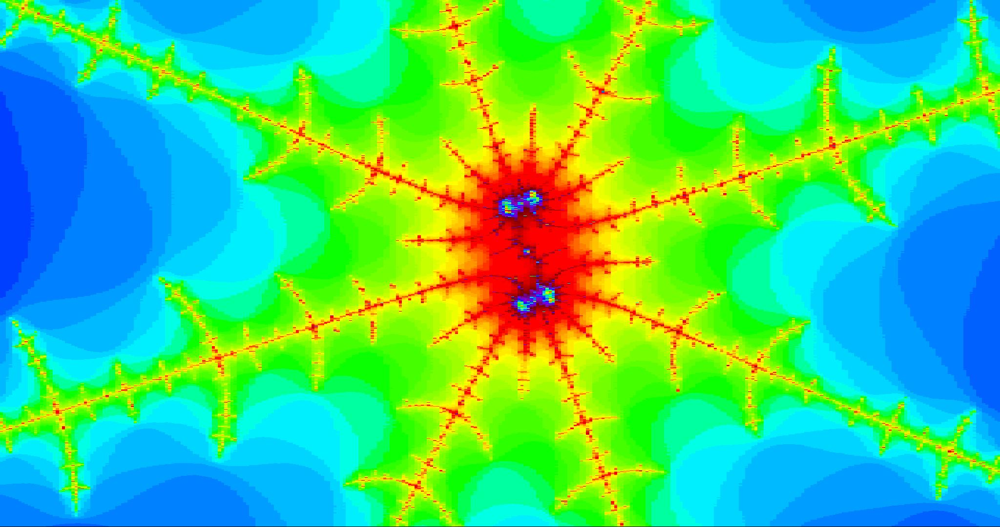
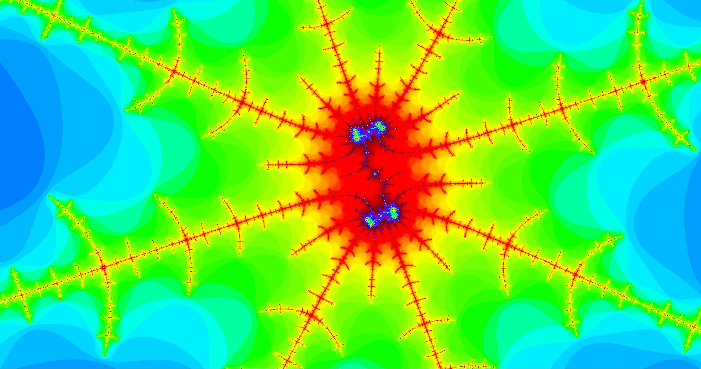
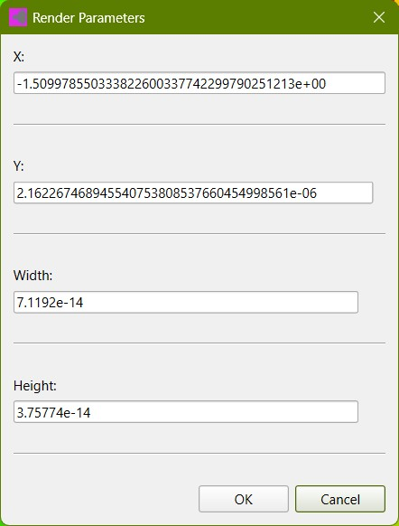

# mandel-thread-typer
A multi-threaded mandelbrot fractal generator with selectable thread and numeric type configurations (to allow the exploration of very small regions beyond the precision of the default numeric types)

This application is based on the Qt Mandelbrot Example code available in the Qt Core documentation. It uses the Boost libraries (Version 1.91.0)


____


  

Images showing the same small region computed using i) 'standard' double precision floating point and ii) 128 bit integer values. Using the larger type for the second image resolves the artefacts seen in the first one, but the calculations take longer.

Why make yet another Mandelbrot demo?
==================================

This was in part a nostalgic trip back to the days my Dad's old 8-bit computer was busy for minutes, hours, sometimes days making these pretty pictures (I was hoping to do things a bit more quickly this time around). 
I also have developed it with the hope it might be a useful tool for trying out some multi-threaded algorithmic ideas and playing around with numeric data types, in C++20, with some quick visual feedback to help explore those ideas.
Nowadays desktop PCs seem to have more and more cores available, so it seems a shame not to use them sometimes....

Development setups (64-bit only)
=======================

Windows
----------
Windows 11

tested with Qt 6.3.2, CMake v4.4.0,  Microsoft Visual Studio Community 2022 (Version 17.14.45)


**Build Instructions**

*In the src subdirectory, use the following:*

```shell
 cmake .

```
*(this may take a while to download required third party libraries)*

*then build the generated Visual Studio solution*

*Qt Creator (tested with v8.0.2) can also import CMake files and can be used with the VS compiler as an alternative flow*

Linux
-------
tested on Ubuntu 26.0.4.1 LTS with Qt 6.11.2, CMake 4.2.3 and gcc 15.2.0 (optionally Qt Creator 20.0.2)


**Build Instructions**

*In the src subdirectory, use the following:*

```bash
cmake .
make

```
*or import the CMake file into Qt Creator, then configure the build setups in the resulting project*


Other
===============
The application should detect the number of CPU cores available (taking into account possible multithreading) and adjust the possible range of worker thread counts accordingly, to leave one or two free for other tasks whilst rendering is underway.

This tool uses the QSettings class in Qt to maintain a .ini file for configuration details (it stores this under the _ShinkuSoft_ name that I sometimes use for my code).

TODOs
===============
* Document/make more visible some UI features (resize, region select, + and - keys)

* Bug fixing - some occasional problems occur
     + e.g. sometimes the renderer shows blank output rather than the computed results, usually when traversing the render history (buffering scheme bug?)
        + investigating...
     + ~~fix incorrect handling of the image offset/size values sometimes seen for very small regions when resizing/moving via the GUI~~
        + this should be fixed as of 24/11/26

* Separate the compute engine and GUI code for software testing and better reusability

* Code tidy (alas, always true)

* ~~make the new render parameters window editable so that render region coordinates can be manually entered~~
     + this is implemented as of 29/3/19

* ~~Better handling of the GUI zoom/region select for very small regions (currently precision is being lost in some cases)~~
     + this should work much better than before, as float128 + string representations (when available) are now used for the region coordinates

* enable gRPC code once it can be reliably deployed (to allow clients to grab rendered images)

* Try some algorithmic improvements:
     + More intelligent sharing of tasks between threads?
       + e.g. allow finer multi-threaded compute control so compute rows can be split (ie have cores working concurrently on pixels with the same row value)
     + ~~use templates for normalization operations to eliminate some function calls~~
     + A dedicated thread for graphics operations only?
     + optimise the end condition code

* HW acceleration? (GPU? FPGA?)
* Adjust the compute kernel to make use of SIMD operations?


